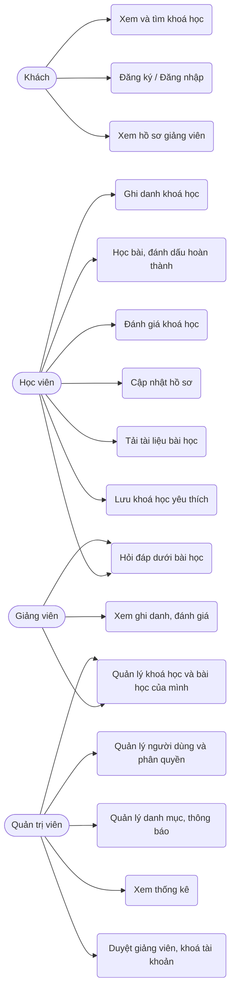
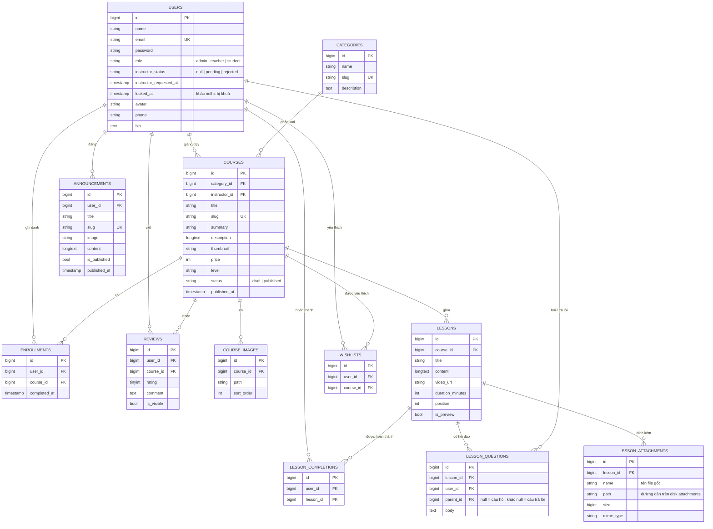

# UTH E-Learning: phân tích hệ thống và thiết kế cơ sở dữ liệu

Tài liệu này tóm tắt phần phân tích và thiết kế để đưa vào slide thuyết trình.

## 1. Công nghệ

| Thành phần | Công nghệ |
| --- | --- |
| Backend | PHP 8.4, Laravel 13 (mô hình MVC) |
| Cơ sở dữ liệu | MySQL (Eloquent ORM, migration) |
| Giao diện | Blade, Tailwind CSS (responsive), Alpine.js |
| Soạn thảo nội dung | CKEditor 5 (rich text, chèn ảnh, bảng, video) |
| Biểu đồ | Chart.js |
| Xác thực | Laravel Breeze (đăng ký, đăng nhập, đăng xuất, quên mật khẩu) |

## 2. Tác nhân và phân quyền

| Vai trò | Quyền chính |
| --- | --- |
| Khách | Xem trang chủ, danh sách và chi tiết khoá học, hồ sơ giảng viên, thông báo; đăng ký tài khoản (chọn Học viên hoặc Giảng viên) |
| Học viên (student) | Ghi danh hoặc huỷ ghi danh, học bài, đánh dấu hoàn thành, làm quiz, xem tiến độ, đánh giá khoá học, đặt câu hỏi dưới bài học, tải tài liệu bài học, lưu khoá học yêu thích, sửa hồ sơ, gửi yêu cầu làm giảng viên |
| Giảng viên (teacher) | Khu `/instructor`: thêm, sửa, xoá khoá học **của mình**, chương, bài học, tài liệu đính kèm, quiz; gửi duyệt; xem học viên; trả lời câu hỏi của học viên |
| Quản trị viên (admin) | Khu `/admin`: duyệt khoá học, danh mục, người dùng (gán vai trò, duyệt yêu cầu làm giảng viên, khoá/mở khoá tài khoản), thông báo, ghi danh, đánh giá, hỏi đáp, ảnh đã lưu, thống kê |

Phân quyền được thực hiện bằng middleware `role:admin,teacher` cho khu quản trị và `CoursePolicy` (giảng viên chỉ sửa khoá học mình phụ trách).

## 3. Chức năng chính

**Trang người dùng**

- Trang chủ: số liệu thống kê, ô truy cập nhanh, danh mục, khoá học nổi bật, thông báo.
- Thư viện khoá học: tìm kiếm, lọc theo danh mục, trình độ, học phí, sắp xếp, **phân trang**.
- Chi tiết khoá học: thư viện **nhiều ảnh**, mô tả rich text, nội dung bài học, đánh giá có phân trang.
- Học bài: video YouTube, nội dung bài, danh sách bài, thanh tiến độ, bài học thử.
- Góc học tập: các khoá đã ghi danh kèm % hoàn thành.

**Trang quản trị**

- Bảng điều khiển: thẻ thống kê, biểu đồ ghi danh 6 tháng, biểu đồ khoá học theo danh mục.
- CRUD đầy đủ: khoá học (ảnh đại diện + upload nhiều ảnh), bài học, danh mục, người dùng, thông báo.
- Quản lý ghi danh, duyệt hoặc ẩn đánh giá.
- Mọi danh sách đều có tìm kiếm, bộ lọc và phân trang.

## 4. Use case tổng quát



## 5. Sơ đồ quan hệ thực thể (ERD)



**Ràng buộc đáng chú ý**

- `enrollments (user_id, course_id)` và `reviews (user_id, course_id)` là UNIQUE: mỗi học viên ghi danh và đánh giá một khoá đúng một lần.
- `lesson_completions (user_id, lesson_id)` và `wishlists (user_id, course_id)` là UNIQUE.
- Xoá câu hỏi xoá luôn các câu trả lời của nó (`lesson_questions.parent_id` cascade).
- Xoá khoá học sẽ xoá dây chuyền bài học, ảnh, ghi danh, đánh giá. Xoá danh mục chỉ đặt `category_id` của khoá học về NULL.

## 6. Bảo mật

- Mật khẩu băm bằng bcrypt; mọi form có CSRF token.
- Nội dung rich text được lọc (`HtmlSanitizer`) trước khi hiển thị: loại bỏ `<script>`, thuộc tính `on*`, `javascript:` và iframe lạ để chống XSS.
- Upload ảnh được kiểm tra định dạng và giới hạn 2MB mỗi ảnh, tối đa 10 ảnh mỗi lần.
- Tài liệu bài học chỉ nhận PDF, Word, PowerPoint, Excel, TXT, ZIP (tối đa 10 MB/tệp), lưu ở nơi không
  công khai (thư mục `storage/app/private` hoặc Cloudinary loại private). Chỉ người được học khoá
  (học viên đã ghi danh, giảng viên phụ trách, admin) tải được, qua route kiểm tra quyền.
- Tài khoản bị khoá không đăng nhập được bằng mật khẩu lẫn Google, và bị đăng xuất ngay ở lần tải
  trang kế tiếp (middleware `EnsureAccountIsNotLocked`).
- Đăng ký chọn "Giảng viên" chỉ tạo yêu cầu chờ duyệt; vai trò chỉ đổi khi admin duyệt.

## 7. Cài đặt và chạy

```bash
composer install
npm install && npm run build
cp .env.example .env   # điền DB_USERNAME, DB_PASSWORD của MySQL
php artisan key:generate
php artisan migrate --seed
php artisan storage:link
php artisan serve
```

Tài khoản mẫu: `admin@example.com` / `Admin@123` (quản trị), `teacher@example.com` / `Teacher@123` (giảng viên), `student@example.com` / `Student@123` (học viên).
